<div align="center">

# TLOTR_TTA_Recomp

**A native Windows, Linux and macOS port of *The Lord of the Rings: The Third Age* (NTSC-U, `SLUS-21027`), made by statically recompiling the game's PlayStation 2 code to C++.**<br>
The game's own code (EE, IOP modules) rebuilt as native code. Its graphics still go through a layer of PS2 emulation (VU1 sandbox, GS state machine, GS memory) drawn with OpenGL; removing it is the work in progress, see below.


</div>

> [!IMPORTANT]
> No game files are included: no ELF, IRX modules, data archives, or code generated from them.
> You need **your own copy** of the North American release, PS2 ID **`SLUS-21027`**. The port is built against that disc's executable:
>
> | File | SHA-1 |
> |---|---|
> | `SLUS_210.27` | `d88ded370592114169fa18f0ff73b9f610a94bd0` |

## Status

**Plays from the boot to the first battle; not playable through yet.** Windows comes first, then Linux and macOS.

| Milestone | |
|---|:---:|
| Map the stripped main ELF (Ghidra function map, SDK functions from the fork's signature database) | ✅ |
| Recompile it and link the generated code with the PS2Recomp runtime (Windows) | ✅ |
| Boot: EE kernel, the game's own IOP modules, EA's heap, first frames on screen | ✅ |
| Loading, memory card check, legal screen | ✅ |
| Movies, title screen | ✅ |
| New Game, the intro cinematic | ✅ |
| First battle | ✅ |
| The first battle played and won; the first chapter | 🔧 |
| Sound and music (the driver runs; not checked by ear yet) | 🔧 |
| Saving to the memory card | ⏳ |
| Linux and macOS builds | ⏳ |
| Full speed, widescreen, higher resolution | ⏳ |

**Native port** (no PS2 hardware emulation left, not even a small part: the shared goal of the fork's ports). Native
means the game's draws built straight from its own data (vertices, matrices, materials), with no GIF packet, no GS
state machine and no copy of GS memory in between.

| Layer | |
|---|:---:|
| IOP modules (sound, streaming, pad, memory card) recompiled to C++, none interpreted | ✅ |
| Game time, sound and IOP on the PC's clock | ✅ |
| No paraLLEl-GS: OpenGL on the GPU | ✅ |
| Frame loop on the PC's clock in game and menus (`PS2X_FRAME_CAP`, default 60; movies still on the vblank) | 🔧 |
| The two hottest VU1 programs (the 3D strips, 0x460 and 0x268) translated to C++, no VU interpreter (`TTA_VU1_PORT=0`: sandbox) | 🔧 |
| Native draws from the game's data, no GIF packet and no GS front end | ⏳ |

Still emulation, to remove:

- **GS front end and `gsWrites`.** Every draw, the C++ ports' included, still carries the PS2 register writes of its
  packet (TEX0, CLUT loads, ALPHA, TEST, ...) and the GS front end replays them through its state machine; the OpenGL
  back end takes textures, CLUTs and targets from that GS state.
- **VU1 sandbox.** Every VU1 program but 0x460 and 0x268 (the characters: 8df1e059 0x10 / 0x190 / 0x1F8, d43b1a88
  0x620, ...) runs as VU1 microcode in the native adapter's sandbox, with VU memory, flags and XGKICK packets.
- **CPU copy of GS memory.** Every texture upload is swizzled pixel by pixel into a CPU copy of GS memory and
  mirrored to a GPU texture (6.8 MB a frame in battle).
- **VIF1 unpacks, VU0 microcode (0xA80, the mesh math), the movies' vblank pacing.**

✅ works · 🔧 in progress · ⏳ not reached yet

[docs/RECOMP_NOTES.md](docs/RECOMP_NOTES.md) records how the port is brought up, every fix and how it was found, and
what remains open.

## Screenshots

<p align="center">
  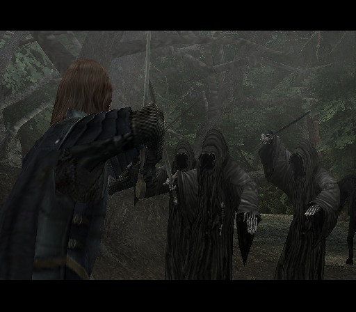
</p>

**2026-10-29.** The Black Riders' cinematic with the VU1 sandbox (now the default): no VU1 program runs on the
emulated VU1 unit, the native adapter runs each one in a sandbox and hands what it draws to the OpenGL renderer in GS
order, replaying each packet's GS register writes. That is still emulation (VU1 microcode, GS state machine), see
above. The first battle, its scene unlock and the film clip after it match the VU1 path, at the same
frame rates (19.5 in battle).

<p align="center">
  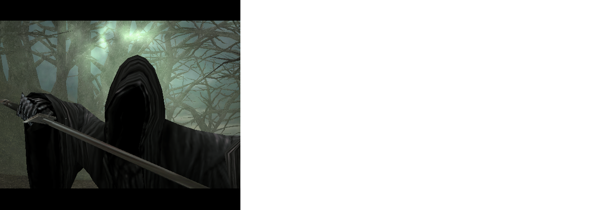
  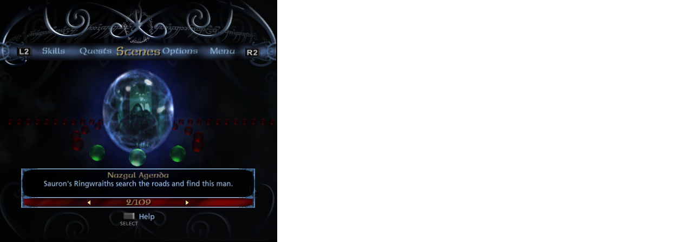
</p>

**2026-10-29.** The first battle played to its end with the Cross button alone (a pad script): the Black Riders'
cinematic, the scene it unlocks (Nazgul Agenda, 2/109) and the film clip that follows, in one 11-minute run.

<p align="center">
  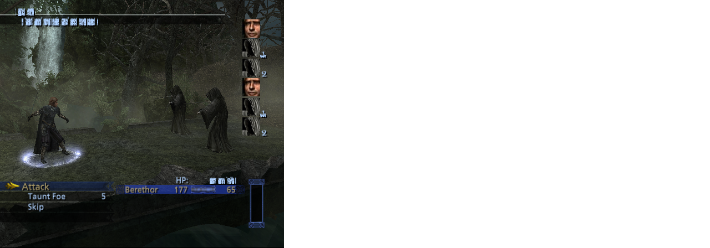
</p>

**2026-10-29.** The first battle (Berethor against two Black Riders), reached with the defaults only: the native
OpenGL renderer, the IOP modules recompiled, the game on the PC's clock. What crashed the intro cinematic in most runs
was CD reads completing at once; they now take drive-like time.

<p align="center">
  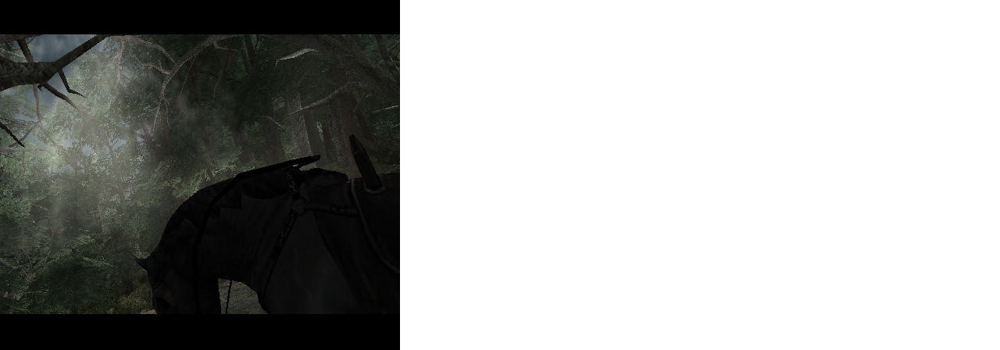
</p>

**2026-10-29.** After New Game: the in-engine intro cinematic, the game's own 3D drawn by the native OpenGL renderer.

<p align="center">
  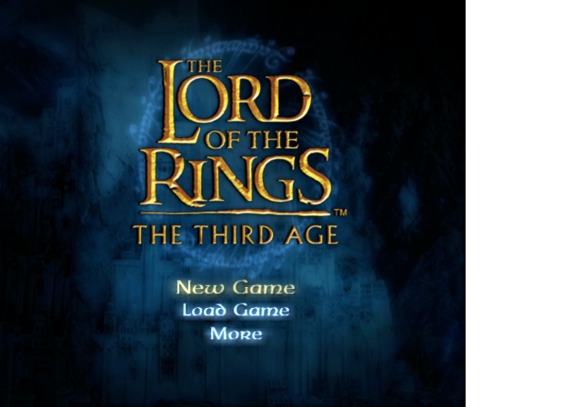
  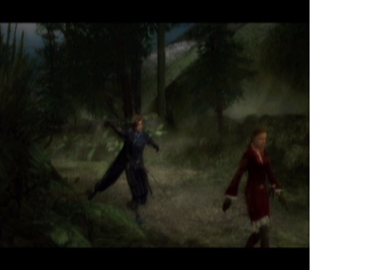
</p>

**2026-10-28.** The title screen, after the EA GAMES and New Line Cinema movies; the attract movie plays and returns
to it. The movies end the way the game signals it (its no-data callback returns 0), fork `tlotr/mpeg-nodata-end`.

<p align="center">
  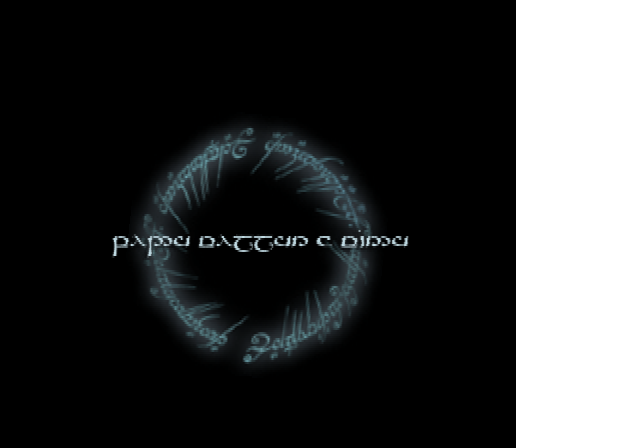
  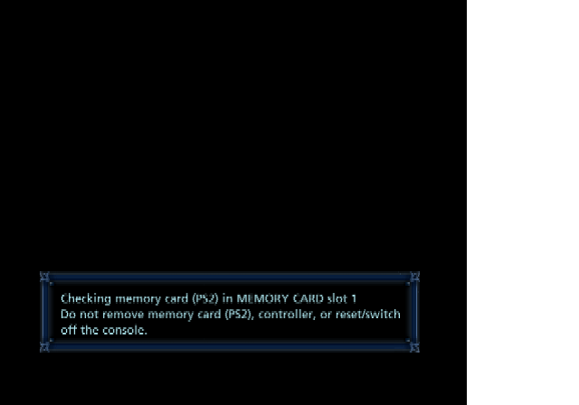
  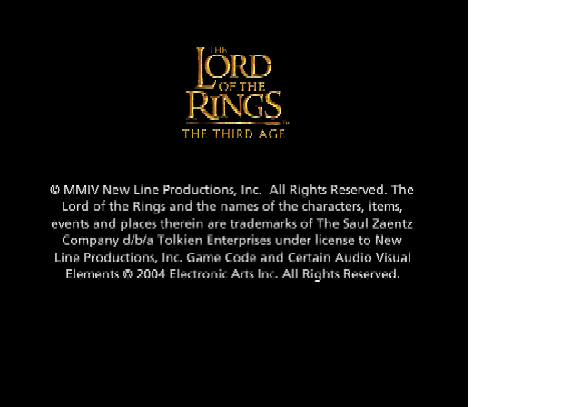
  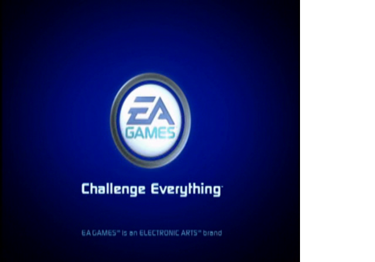
</p>

**2026-10-27.** The loading screen, the memory card check, the legal screen and the first boot movie, drawn by the
recompiled code. The disc is read
through the game's own IOP sound and streaming module, and the VU1 microprograms run AOT-compiled (with exact
MAC/status flags for now). The white band on the right is outside the 516-pixel-wide area the game draws in this
build.

<details>
<summary>2026-10-26: first frames</summary>

<p align="center">
  
</p>

The ring of the loading screen turned, but its text was garbled and the game never read the disc.
</details>

## Goal

A fully playable *The Third Age* as a native executable on Windows, Linux and macOS, from the intro to the end of the
campaign. Accuracy first; once it is playable, widescreen and higher internal resolution.

## How it works

```
disc files (game/) ──► Ghidra (headless, EE extension) + ExportPS2Functions ──► recomp/ghidra/tta_functions.csv
                   ──► ps2_analyzer (SCE SDK signatures) ──► recomp/tta_slus21027.toml (stubs, entry points)
                                           │
                     ps2_recomp ──► C++ (one file per function, generated/) · ps2_vu_aot ──► VU microcode (generated/vu1/)
                     tools/iop_recomp.py ──► the IRX modules as C++ (generated/iop/, scripts/iop_recomp.sh)
                                           │
                 CMakeLists.txt ──► PS2Recomp runtime + generated code + runtime/ (TTA's overrides)
                                           │
   PS2Recomp runtime: EE kernel HLE · DMAC · GIF + native OpenGL GS renderer · VIF/VU · IPU ─┼─► ps2EntryRunner
   PS2Recomp IOP:     the game's IRX as recompiled code · SPU2 on the PC's clock · SIO2
```

- The retail executable is stripped. Ghidra with the Emotion Engine extension maps its functions, and `ps2_analyzer`
  names the Sony SDK functions that have runtime handlers from the fork's signature database (102 at first pass).
- PS2Recomp turns every function into C++ and emits the address-indexed function table.
- The top-level `CMakeLists.txt` builds the fork's runtime, swaps its placeholder function table for the generated one
  and links everything into `ps2EntryRunner`.
- `runtime/tta_overrides.cpp` holds the game-specific bindings and defaults (native GS renderer, recompiled IOP
  modules, COP0 Count on the PC's clock, drive-like CD timing); `runtime/tta_native.cpp` the native rendering work.

The PS2Recomp fork lives in `PS2Recomp/` (git submodule, [boubou666/PS2Recomp](https://github.com/boubou666/PS2Recomp)),
shared with the *Twisted Metal: Black*, *Valkyrie Profile 2* and *Drakengard* recompilations.

## Requirements

- Windows 10/11 with [MSYS2](https://www.msys2.org/) (UCRT64), Linux, or macOS
- CMake 3.21+, Ninja, GCC 13+ or Clang with C++20
- FFmpeg development libraries (`libavcodec`, `libavformat`, `libavutil`, `libswresample`, `libswscale`) and `pkg-config`
- `bsdtar` (libarchive) to extract the disc, Python 3
- To regenerate the function map: [Ghidra](https://ghidra-sre.org/) 12 with the
  [Emotion Engine extension](https://github.com/chaoticgd/ghidra-emotionengine-reloaded) and a JDK 21
- A CPU with AVX2 (the runtime is built for `x86-64-v3`)
- Your own copy of `SLUS-21027` (check the hash above)

## Build and run

```bash
git clone --recurse-submodules https://github.com/boubou666/TLOTR_TTA_Recomp.git
cd TLOTR_TTA_Recomp
scripts/extract_iso.sh "/path/to/Lord of the Rings, The - The Third Age (USA).iso"   # disc files -> game/
scripts/build_tools.sh                                   # ps2_recomp, ps2_analyzer, ps2_vu_aot -> build/tools
GHIDRA_INSTALL_DIR=/path/to/ghidra scripts/ghidra.sh     # only to regenerate recomp/ghidra/tta_functions.csv
scripts/recomp.sh                                        # ELF + recomp/tta_slus21027.toml -> generated/
scripts/iop_recomp.sh                                    # boots once, recompiles the IRX modules -> generated/iop/
scripts/build_runtime.sh                                 # runtime + generated code -> build/game
scripts/run.sh                                           # ps2EntryRunner game/SLUS_210.27
```

### Windows

The same scripts run in an MSYS2 **UCRT64** shell, with MSYS2's GCC (MSVC is not supported for this port).

```bash
pacman -S --needed mingw-w64-ucrt-x86_64-{gcc,cmake,ninja,pkgconf,ffmpeg,libarchive,python} git
```

`scripts/stage_dlls.sh` copies the DLLs the runner needs next to `ps2EntryRunner.exe`, so it can also be started
outside the MSYS2 shell.

`scripts/analyze.sh` regenerates the TOML from scratch; it discards manual edits, so diff before committing.

## Sharing the machine with other ports

Several PS2Recomp ports are developed on the same machine and share a two-slot bench lock (the fork's
`tools/bench_lock.sh`): a game run takes one slot, a build or a timed run takes both, in arrival order.

```bash
scripts/bench_lock.sh take 15 "boot check"           # a game run: one slot
scripts/bench_lock.sh take 20 "full rebuild" alone   # a build or a timed run: the whole bench
scripts/bench_lock.sh release
```

## Legal

This project contains no code or data from the game. You must own the game to use it. *The Lord of the Rings: The
Third Age* is a trademark of its respective owners; this project is not affiliated with or endorsed by them.
