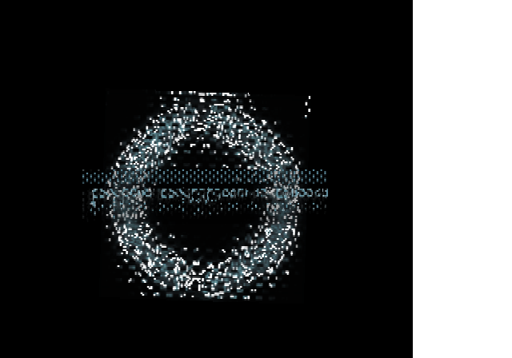

<div align="center">

# TLOTR_TTA_Recomp

**A native Windows, Linux and macOS port of *The Lord of the Rings: The Third Age* (NTSC-U, `SLUS-21027`), made by statically recompiling the game's PlayStation 2 code to C++.**<br>
Not an emulator: the game's own MIPS R5900 code, rebuilt as a native program on a reimplementation of the PS2 hardware.


</div>

> [!IMPORTANT]
> No game files are included: no ELF, IRX modules, data archives, or code generated from them.
> You need **your own copy** of the North American release, PS2 ID **`SLUS-21027`**. The port is built against that disc's executable:
>
> | File | SHA-1 |
> |---|---|
> | `SLUS_210.27` | `d88ded370592114169fa18f0ff73b9f610a94bd0` |

## Status

**Bring-up, not playable yet.** Windows comes first, then Linux and macOS.

| Milestone | |
|---|:---:|
| Map the stripped main ELF (Ghidra function map, SDK functions from the fork's signature database) | ✅ |
| Recompile it and link the generated code with the PS2Recomp runtime (Windows) | ✅ |
| Boot: EE kernel, the game's own IOP modules, EA's heap, first frames on screen | ✅ |
| Loading: CD reads from the disc files | 🔧 |
| Movies, title screen, menus | ⏳ |
| First battle | ⏳ |
| Sound and music | ⏳ |
| Memory card | ⏳ |
| Linux and macOS builds | ⏳ |
| Full speed, widescreen, higher resolution | ⏳ |

✅ works · 🔧 in progress · ⏳ not reached yet

[docs/RECOMP_NOTES.md](docs/RECOMP_NOTES.md) records how the port is brought up, every fix and how it was found, and
what remains open.

## Screenshots

<p align="center">
  
</p>

**First frames, 2026-10-26.** The game's loading screen, drawn by the recompiled code: the ring turns, double
buffered. It does not get further yet. The line of text is garbled, and the white band on the right is outside
the 516-pixel-wide area the game draws in this build.

## Goal

A fully playable *The Third Age* as a native executable on Windows, Linux and macOS, from the intro to the end of the
campaign. Accuracy first; once it is playable, widescreen and higher internal resolution.

## How it works

```
disc files (game/) ──► Ghidra (headless, EE extension) + ExportPS2Functions ──► recomp/ghidra/tta_functions.csv
                   ──► ps2_analyzer (SCE SDK signatures) ──► recomp/tta_slus21027.toml (stubs, entry points)
                                           │
                     ps2_recomp ──► C++ (one file per function, generated/) · ps2_vu_aot ──► VU1 microcode (generated/vu1/)
                                           │
                 CMakeLists.txt ──► PS2Recomp runtime + generated code + runtime/tta_overrides.cpp
                                           │
   PS2Recomp runtime: EE kernel HLE · DMAC · GIF/GS · VIF/VU0/VU1 · IPU ─┼─► ps2EntryRunner
   PS2Recomp IOP:     R3000A interpreter running the game's own IRX · SPU2 · SIO2
```

- The retail executable is stripped. Ghidra with the Emotion Engine extension maps its functions, and `ps2_analyzer`
  names the Sony SDK functions that have runtime handlers from the fork's signature database (102 at first pass).
- PS2Recomp turns every function into C++ and emits the address-indexed function table.
- The top-level `CMakeLists.txt` builds the fork's runtime, swaps its placeholder function table for the generated one
  and links everything into `ps2EntryRunner`.
- `runtime/tta_overrides.cpp` holds the game-specific bindings.

The PS2Recomp fork lives in `PS2Recomp/` (git submodule, [boubou666/PS2Recomp](https://github.com/boubou666/PS2Recomp)),
shared with the *Twisted Metal: Black*, *Valkyrie Profile 2* and *Drakengard* recompilations.

## Requirements

- Windows 10/11 with [MSYS2](https://www.msys2.org/) (UCRT64), Linux, or macOS
- CMake 3.21+, Ninja, GCC 13+ or Clang with C++20
- FFmpeg development libraries (`libavcodec`, `libavformat`, `libavutil`, `libswresample`, `libswscale`) and `pkg-config`
- `bsdtar` (libarchive) to extract the disc, Python 3
- To regenerate the function map: [Ghidra](https://ghidra-sre.org/) 12 with the
  [Emotion Engine extension](https://github.com/chaoticgd/ghidra-emotionengine-reloaded) and a JDK 21
- A CPU with AVX2 (the runtime is built for `x86-64-v3`)
- Your own copy of `SLUS-21027` (check the hash above)

## Build and run

```bash
git clone --recurse-submodules https://github.com/boubou666/TLOTR_TTA_Recomp.git
cd TLOTR_TTA_Recomp
scripts/extract_iso.sh "/path/to/Lord of the Rings, The - The Third Age (USA).iso"   # disc files -> game/
scripts/build_tools.sh                                   # ps2_recomp, ps2_analyzer, ps2_vu_aot -> build/tools
GHIDRA_INSTALL_DIR=/path/to/ghidra scripts/ghidra.sh     # only to regenerate recomp/ghidra/tta_functions.csv
scripts/recomp.sh                                        # ELF + recomp/tta_slus21027.toml -> generated/
scripts/build_runtime.sh                                 # runtime + generated code -> build/game
scripts/run.sh                                           # ps2EntryRunner game/SLUS_210.27
```

### Windows

The same scripts run in an MSYS2 **UCRT64** shell, with MSYS2's GCC (MSVC is not supported for this port).

```bash
pacman -S --needed mingw-w64-ucrt-x86_64-{gcc,cmake,ninja,pkgconf,ffmpeg,libarchive,python} git
```

`scripts/stage_dlls.sh` copies the DLLs the runner needs next to `ps2EntryRunner.exe`, so it can also be started
outside the MSYS2 shell.

`scripts/analyze.sh` regenerates the TOML from scratch; it discards manual edits, so diff before committing.

## Sharing the machine with other ports

Several PS2Recomp ports are developed on the same machine. A timed game run or benchmark takes the shared bench lock
first, so that another port's build or game does not skew it:

```bash
scripts/bench_lock.sh take 15 "boot timing"   # waits until the lock is empty and no other port's game runs
scripts/run.sh ...
scripts/bench_lock.sh release
```

Heavy builds take no lock, but do not start while someone holds it.

## Legal

This project contains no code or data from the game. You must own the game to use it. *The Lord of the Rings: The
Third Age* is a trademark of its respective owners; this project is not affiliated with or endorsed by them.
